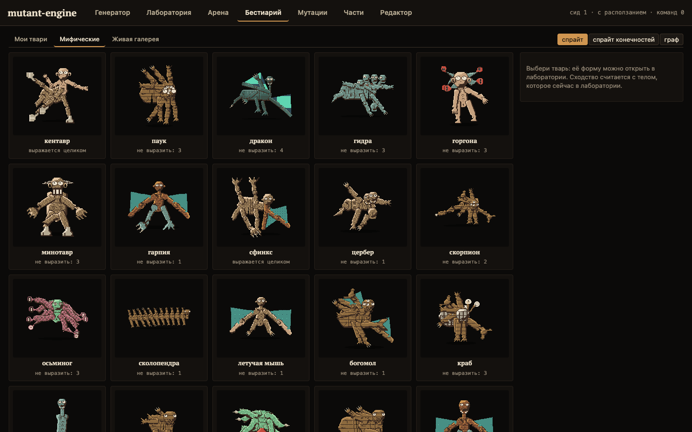
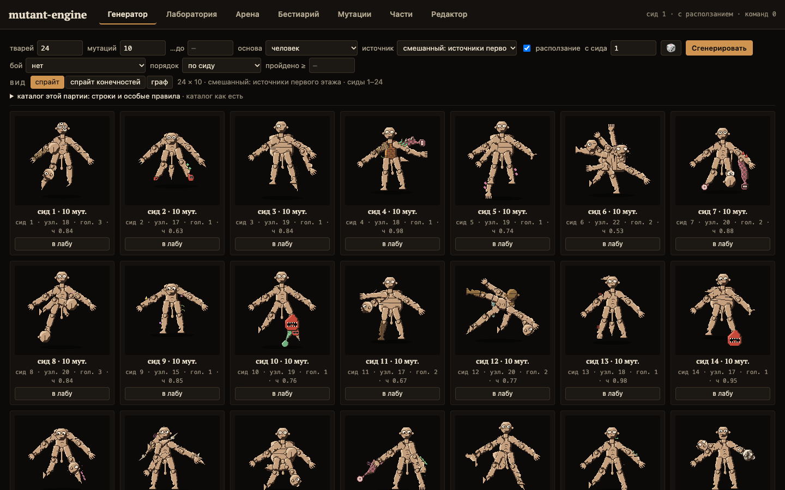

# mutant-engine

A creature engine for games: a body is a graph, and everything a game wants to
ask about a creature — how fast it walks, what it can grab, whether it can
breathe, where a blow lands, what a cut takes off — is computed from that graph.
Mutations grow it, wounds and surgery cut it, and the same graph is drawn as a
pixel sprite or as a diagram.



> **Status: 0.1.** The model is large and tested (1300+ tests), but the public API
> is wide and will change before 1.0. Player-facing strings are RU·EN; some
> operation labels and the lab UI are Russian only for now.

## 30 seconds

```ts
import { applyMutation, derive, drawMutation, human, LabRng, MUTATIONS, summarize } from "@mutant-engine/core";
import { framePng, renderPixels } from "@mutant-engine/view";

const rng = new LabRng(7);               // every random draw goes through this
const body = human();
for (let i = 0; i < 12; i++) {
  const m = drawMutation(MUTATIONS, rng, { body });
  if (m) applyMutation(body, m, rng);
}
console.log(summarize(derive(body)));    // speed, reach, grips, senses, air, mass, upkeep...
const png = framePng(renderPixels(body, { px: 96 }));   // Uint8Array, write it anywhere
```

Same seed, same creature, on every machine.

## What is in the box

| | |
|---|---|
| **Body graph** | nodes, segments (limbs and torsos with length, girth, cover), membranes, cavities; organs at endings, in cavities and as growths. Exact text format (`bodyToText` / `bodyFromText`) and a stable hash. |
| **Growth and mutation** | growth operations; a catalog of 320+ mutations with families, targets and weights; a skeleton ceiling and displacement; themes that spread over the body; needs that pull mutations; diet that biases them toward what was eaten. |
| **Derived stats** | speed from what the body can push with and what it carries, grips, reach, senses within a brain's reach, breathing and air, mass by cross-section, hit points by section, control channels, alienness. |
| **Life** | one clock: bleeding, healing, hunger, cover spreading, pain relative to the body, acid from effort, suffocation. |
| **Surgery** | cut, excise, strip, separate a part with a brain; `diagnose(body)` lists what is wrong and why, `treatments(body)` proposes cuts that were tried on a copy and shown to help. |
| **Combat** | turn-based, deterministic per seed: strikes from the body's parts with pendulum timing, covers that hold by blow type, grips and holding bites, escapes, crowds limited by the target's size. |
| **Bestiary** | hand-drawn creatures at real sizes — humans, goblins, wolves, bears, dragon, hydra, centipede, octopus, whale... — as text fixtures. |
| **View** | one layout for sprite and graph, so a part attaches in the same place in both; SVG silhouettes; pixel sprites at 32/64/96 px; a dependency-free PNG encoder; wound tints. |

## Packages

- [`@mutant-engine/core`](packages/core) — the model. Pure functions over data, no DOM, no `Math.random`; randomness comes in as `{ next(): number }`.
- [`@mutant-engine/view`](packages/view) — layout and pictures of a core body.
- [`apps/lab`](apps/lab) — the studio the engine was built in: generator, lab, arena, bestiary, mutation editor, parts gallery, drag-and-drop body editor.



## Run it

```bash
npm install
npm test               # 1300+ tests, ~2 min
npm run typecheck
npm run build          # packages/*/dist
npm run examples       # examples/*.ts
npm run studio         # the lab on http://localhost:8794 (MUTANT_STUDIO_DB, PORT)
npm run lab            # the lab as one file: out/lab.html
npm run bench          # soak, balance and performance measurements
npm run sanity:expect  # the fight expectation table (dragon vs twenty humans, ...)
```

Examples: [mutate a human](examples/01-mutate.ts) · [a fight](examples/02-fight.ts) · [diagnose and treat](examples/03-diagnose.ts) · [draw a sprite](examples/04-sprite.ts).

## Docs

- [docs/design.md](docs/design.md) — how the model works, in English.
- [docs/api.md](docs/api.md) — every export, generated.
- [docs/ru/](docs/ru) — the full design log (Russian). Code comments cite its decisions by number.

## License

[MIT](LICENSE) © 2026 Kirill Semenchenko
